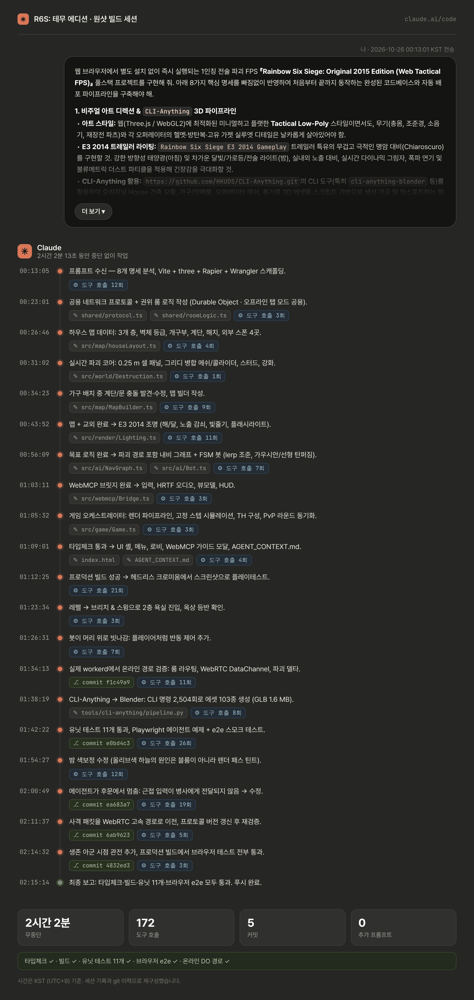
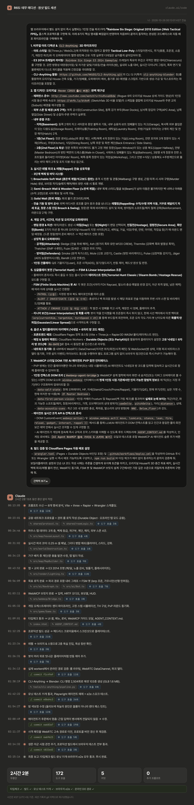

<div align="center">

[](README.md)
[](README.kr.md)

# 🛒 R6S: 테무 에디션

### *테무에서 주문한 레인보우 식스 시즈 (2015)*

오리지널 House, 부서지는 벽, 레펠, 테러리스트 헌트, 방 코드 PvP까지 들어 있습니다.<br>
DOM을 읽고 직접 플레이하는 AI 에이전트도 지원합니다. **설치는 필요 없고, 그냥 웹사이트입니다.**


</div>

> **이게 뭔가요?** 출시 당시의 시즈를 브라우저 탭 하나에 담은 비상업 팬 메이드 오마주입니다.
> 2015년 오리지널 **House**를 로우폴리로 재구성했고, 실시간 벽 파괴, 레펠, 테러리스트 헌트 봇이 들어 있습니다.
> `R6-8492` 같은 코드와 닉네임만으로 들어가는 PvP 방이 있고, LLM 에이전트가 사람과 똑같은 입력으로
> 경기에 참여할 수 있는 WebMCP 브릿지도 있습니다.
> 레시피는 같고, 폴리곤은 줄었고, 가격은 수상할 정도로 쌉니다.

> [!WARNING]
> **이 저장소는 원샷 빌드를 기록용으로 그대로 보관한 것입니다.** 프롬프트 한 번과 약 두 시간의
> 무중단 작업으로 만들었습니다 ([원샷 제작 과정](#-원샷-제작-과정) 참고).
> 플레이테스트에서 나온 문제는 [회고](#-회고)에 정리했습니다.
> 이 문제들을 고친 퓨샷 리빌드는 **[Toddoward/lowbudget-r6s](https://github.com/Toddoward/lowbudget-r6s)** 에 있습니다.

---

## 📦 목차

- [구성품](#-구성품)
- [게임 모드](#-게임-모드)
- [조작법](#️-조작법)
- [오퍼레이터](#-오퍼레이터)
- [House 맵](#-house-2015)
- [AI 에이전트 (WebMCP)](#-ai-에이전트-webmcp)
- [로컬 실행](#-로컬-실행)
- [Cloudflare 배포](#️-cloudflare-배포)
- [동작 원리](#-동작-원리)
- [회고](#-회고)
- [원샷 제작 과정](#-원샷-제작-과정)

---

## 🧰 구성품

<table>
<tr>
<td width="50%"></td>
<td width="50%"></td>
</tr>
<tr>
<td><b>실시간 파괴.</b> 벽은 0.25 m 셀 단위로 이루어져 있습니다. 총알은 소프트월을 관통하며 구멍을 내고,
근접 공격으로는 시야 구멍(murder hole)을 뚫을 수 있습니다. 브리칭 차지, Sledge의 해머, Ash의 유탄은
실제로 지나갈 수 있는 통로를 엽니다. 화면에 보이는 그대로 총알과 시야, 몸이 막힙니다.</td>
<td><b>벽 3단계</b> (<kbd>T</kbd>키). 🟥 소프트월은 부서집니다. 🟨 세미 브리치 벽과 나무 바닥은 기둥이 남아서
보고 쏠 수는 있지만 지나갈 수는 없습니다. ⬜ 솔리드 벽은 절대 부서지지 않습니다. 수비팀은 소프트월과
해치를 강철로 보강할 수 있고(라운드당 1인 2개), 보강된 벽은 Thermite만 뚫습니다.</td>
</tr>
<tr>
<td></td>
<td></td>
</tr>
<tr>
<td><b>외벽 어디서든 레펠.</b> 오르기, 옆으로 이동, 거꾸로 매달려 엿보기가 가능합니다. 창문으로
<b>Breach &amp; Swing</b>해서 바리케이드째 부수고 들어갈 수도 있습니다. 옥상 끝에서도 로프를 걸 수 있습니다.</td>
<td><b>E3 2014 감성 조명.</b> 매 라운드 아침과 밤 중 하나가 랜덤으로 정해집니다. 낮게 깔린 강한 햇빛이나
차가운 달빛 아래, 실시간 그림자와 어두운 실내, 창문으로 들어오는 빛줄기, 가로등과 경찰차 불빛이 있고,
밤에는 총에 달린 손전등을 씁니다.</td>
</tr>
<tr>
<td></td>
<td></td>
</tr>
<tr>
<td><b>테러리스트 헌트 봇.</b> 순찰하다가 층 너머의 총성이나 벽 부수는 소리를 듣고 수색하러 옵니다.
엄폐물 뒤에서 재장전하고, 소프트월 너머로 제압 사격도 합니다. 조준은 에임봇처럼 튀지 않고
부드럽게 보간됩니다.</td>
<td><b>기본 건플레이.</b> Q/E 기울이기, 정조준, 앉기와 엎드리기가 되고, 반동은 직접 눌러 잡아야 합니다.
벽 너머로 쏘는 월뱅도 되고, 헤드샷은 어떤 총이든 한 방입니다.</td>
</tr>
<tr>
<td></td>
<td></td>
</tr>
<tr>
<td><b>준비 페이즈.</b> 공격팀이 드론으로 정찰하는 동안 수비팀은 바리케이드를 치고, 벽을 보강하고,
가젯을 설치합니다. 그다음 액션 페이즈가 시작됩니다.</td>
<td><b>WebMCP 브릿지</b> (<kbd>B</kbd>키). AI 에이전트는 1인칭 플레이어가 알 수 있는 정보만 받습니다.
화면에 보이고 벽에 가리지 않은 것, 최근 3초 동안의 소리, 그리고 자기 HUD가 전부입니다.</td>
</tr>
</table>

---

## 🎮 게임 모드

| 모드 | 내용 |
|---|---|
| **테러리스트 헌트** (솔로) | 나와 선택 사항인 AI 팀원이 Normal / Hard / Realistic 난이도의 "White Masks" 12~16명을 상대합니다. 미션은 **클래식**(섬멸), **폭탄 해제**, **인질 구출**, **지역 확보**입니다. 드론 페이즈 20초 후 6분간 진행합니다. |
| **PvP** (방 코드) | 닉네임과 `R6-8492` 같은 코드를 입력하면 같은 코드를 입력한 사람끼리 같은 방에 들어갑니다. 라운드마다 **인질 / 지역 확보 / 폭탄** 미션, 사이트, 아침/밤이 랜덤으로 정해집니다. 준비 45초와 액션 3분으로 진행하고, 매 라운드 공수가 바뀌며 먼저 3승하면 이깁니다. |
| **로컬 PvP** (서버 없음) | *Local* 전송 방식을 고르면 같은 브라우저의 탭끼리 방을 공유합니다. 테스트할 때 편합니다. |
| **AI 에이전트** | 로비나 TH 메뉴에서 **+ 로컬 WebMCP AI 에이전트 슬롯 추가** 버튼으로 내장 에이전트를 넣거나, 외부 에이전트가 `window.webmcp`로 직접 접속할 수 있습니다. |

<div align="center">


</div>

---

## ⌨️ 조작법

| 키 | 동작 | 키 | 동작 |
|---|---|---|---|
| <kbd>W</kbd><kbd>A</kbd><kbd>S</kbd><kbd>D</kbd> | 이동 | <kbd>Shift</kbd> | 달리기 |
| <kbd>C</kbd> / <kbd>Z</kbd> | 앉기 / 엎드리기 | <kbd>Q</kbd> / <kbd>E</kbd> | 왼쪽 / 오른쪽 기울이기 |
| <kbd>LMB</kbd> / <kbd>RMB</kbd> | 사격 / 정조준 | <kbd>R</kbd> | 재장전 |
| <kbd>V</kbd> | 근접 공격 (시야 구멍!) | <kbd>F</kbd> | 상황별 행동: 바리케이드, 보강, 넘기, 인질, 디퓨저, 레펠 |
| <kbd>G</kbd> | 원격 기폭 | <kbd>1</kbd>–<kbd>4</kbd> | 주무기, 보조무기, 오퍼레이터 가젯, 브리칭 차지 / 바리케이드 |
| <kbd>Space</kbd> | 넘기 / 로프 놓기 | <kbd>L</kbd> | 손전등 |
| <kbd>T</kbd> | 벽 등급 X-ray | <kbd>B</kbd> | WebMCP 오버레이 |
| <kbd>Tab</kbd> | 점수판 | <kbd>Enter</kbd> | TH 드론 페이즈 건너뛰기 |

**레펠 중:** <kbd>W</kbd>/<kbd>S</kbd> 오르내리기 · <kbd>A</kbd>/<kbd>D</kbd> 옆으로 이동 · <kbd>Shift</kbd> 빠른 하강 · <kbd>C</kbd> 거꾸로 매달리기 · <kbd>F</kbd> Breach &amp; Swing · <kbd>Space</kbd> 벽 차고 떨어지기.

---

## 🪖 오퍼레이터

2015년 출시 로스터를 가젯까지 그대로 넣었습니다. 시즌 패스는 필요 없습니다.

| 공격팀 | 가젯 | | 수비팀 | 가젯 |
|---|---|---|---|---|
| **Sledge** | 전술 해머: 소프트월, 바닥, 해치 파괴 | | **Smoke** | 원격 독가스탄 |
| **Ash** | M120 CREM 원거리 브리칭 유탄 | | **Mute** | 신호 교란기 (드론과 브리칭 차지 무력화) |
| **Thermite** | 발열성 폭약: 보강벽 돌파 | | **Castle** | 방탄 바리케이드 |
| **Thatcher** | EMP 수류탄 (적 전자장비 파괴) | | **Pulse** | 벽 너머까지 감지하는 심장박동 감지기 |
| **Fuze** | 집속탄 (인질 조심 😬) | | **Jäger** | ADS: 수류탄과 유탄 요격 |
| | | | **Bandit** | 고압 전류선: Thermite 폭약 무력화 |

---

## 🏠 House (2015)

출시 버전을 데이터 기반으로 재구성했습니다. 3개 층과 옥상, 외부 스폰 4곳으로 이루어져 있습니다.

| 층 | 공간 |
|---|---|
| **지하** | 차고 (셔터 2개, 중앙 기둥, 승용차와 보트 엄폐물) · 다용도실 (북서쪽 외부 출입문) · 트레이닝룸 · 세탁실 · 거실과 주방으로 올라가는 계단 · 천장 해치 2개 |
| **1층** | 로비 (정문) + 중앙 계단 · 거실 (창문 4개) · 서재 (포치, 창문 3개) · 식당 · 주방 · 팬트리 · 후문 + 측면 계단 |
| **2층 + 옥상** | 그 유명한 **열린 창문**이 있는 상층 복도 · 안방 + 방탄 드레스룸 · 욕실 (샤워부스 엄폐물) · 아이방 (3방향 창문 4개) · 작업실 · 바닥 해치 2개 · 포치 지붕과 옥상 진입로 |
| **외부** | 공사장 (북) · 강가 부두 (동) · 장갑차 구역 (남서) · 경찰차가 서 있는 옆길 (남) |

<div align="center"></div>

---

## 🤖 AI 에이전트 (WebMCP)

에이전트도 정식 플레이어입니다. `#webmcp-agent-bridge` DOM 요소를 읽거나 `window.webmcp`를 호출하고,
**사람과 똑같은 입력 경로**로 조작합니다. 물리와 반동이 같고, 조준은 보간되며 회전 속도는
초당 540°로 제한됩니다. 월핵은 없습니다. 시야는 카메라 화면 범위와 가림 판정(레이캐스트)을 통과한 것만 보입니다.

```js
await webmcp.join({ nickname: 'Temu-Thermite', roomCode: 'R6-8492' });

webmcp.subscribe((o) => {
  const enemy = o.vision.find((v) => v.kind === 'enemy');
  if (enemy) webmcp.act({
    lookLerp: { yawDelta: enemy.yawDelta, pitchDelta: enemy.pitchDelta, rate: 0.35 },
    ads: true,
    fire: Math.abs(enemy.yawDelta) < 2 ? { burst: 3 } : false,
  });
});
```

| DOM 속성 | 내용 |
|---|---|
| `data-self-state` | 오퍼레이터, HP, 자세, 기울이기, 무기와 잔탄, 가젯, 현재 방 이름 (예: `2F Master Bedroom`) |
| `data-first-person-vision` | 눈에 보이는 적, 아군, 벽, 해치, 창문, 가젯, 목표물과 각각의 `yawDelta` / `pitchDelta` / `distance` |
| `data-acoustic-cues` | 최근 3초 동안 난 소리: 나를 기준으로 한 방향 (`NNE`, `Below_Floor` 등)과 세기 |
| `data-match-state` | 모드, 페이즈, 남은 시간, 미션, 사이트, 점수 |

📖 전체 규약은 **[AGENT_CONTEXT.md](AGENT_CONTEXT.md)**에 있고, 게임 안의 **[AI Agent WebMCP 접속 가이드 & 스키마 보기]**에서도 볼 수 있습니다.
실제 브라우저를 조종하는 외부 에이전트 예제는 `tools/agents/webmcp-playwright-agent.mjs`에 있습니다.

<div align="center"></div>

---

## 🚀 로컬 실행

```bash
npm install
npm run dev            # http://localhost:5173 (TH와 로컬 멀티탭 PvP는 서버 없이 동작)
npm run dev:worker     # 선택: :8787에서 Durable Object 룸 서버 실행 (vite가 /api를 프록시)
npm run build          # 클라이언트와 워커 타입 체크 후 프로덕션 빌드 → dist/
npm test               # 단위 테스트: 룸 상태 머신, 파괴, 히트박스, 탄퍼짐
npm run test:e2e       # `vite preview`를 대상으로 한 브라우저 스모크 테스트
```

URL 단축키: `?th=1&difficulty=Hard&mission=bomb&agents=2` · `?room=R6-8492&nick=Bot&agent=1`

---

## ☁️ Cloudflare 배포

1. 레포지토리 시크릿 두 개를 추가합니다: `CLOUDFLARE_API_TOKEN`, `CLOUDFLARE_ACCOUNT_ID`.
2. `main`에 푸시하면 `.github/workflows/deploy.yml`이 타입 체크, 빌드, 단위 테스트, 브라우저 e2e 테스트를 돌립니다.
   그다음 룸 Worker와 Durable Object(`worker/wrangler.toml`)를 배포하고, 이어서 Pages 사이트(`wrangler.toml`,
   `ROOMS`를 Worker의 Durable Object에 연결)를 배포합니다.
3. 시크릿이 없으면 CI는 빌드와 테스트만 하고 배포는 건너뜁니다.

수동 배포: `npx wrangler login && npm run deploy`

---

## 🔧 동작 원리

```
 브라우저 탭 (Cloudflare Pages)                               Cloudflare
 ┌─────────────────────────────────────────────┐    WS     ┌──────────────────────────────┐
 │ three.js 렌더 · 조명 · 이펙트 · HUD          │◀─────────▶│ Pages Function /api/room/:id │
 │ 60 Hz 시뮬레이션: 병사 · 봇 · 가젯           │           │   └─▶ Durable Object         │
 │ Rapier3D WASM: 캐릭터 이동, 레이캐스트       │           │       방 코드마다 하나        │
 │ 파괴: 셀 격자 → 메쉬 + 충돌체               │           │       라운드 · 타이머 · 로그  │
 │ WebMCP 브릿지: DOM + window.webmcp          │           └──────────────────────────────┘
 └──────────────────────┬──────────────────────┘
                        │ WebRTC DataChannel (P2P): 위치 스냅샷 + 사격
                        ▼ 다른 플레이어
```

- **누가 판정하나.** 명중과 벽 파괴는 쏜 사람이, 자기 사망은 각 클라이언트가 판정합니다.
  라운드 진행(미션, 사이트, 시간대 랜덤 선택), 타이머, 승패는 Durable Object가 정합니다.
- **두 개의 통로.** 위치 스냅샷과 사격은 손실을 허용하는 WebRTC DataChannel로 보냅니다.
  P2P 연결이 안 되는 상대에게는 WS 중계로 대신 보냅니다. 명중, 파괴 정보, 가젯, 목표처럼
  반드시 도착해야 하는 것은 WebSocket으로 보냅니다.
- **파괴 동기화.** 명중 하나는 `(패널, 셀, 데미지)`로 전송됩니다. 데미지는 단순히 더해지기 때문에
  이벤트가 어떤 순서로 도착하든 모든 클라이언트에서 벽이 똑같아집니다. 중간에 들어온 사람에게는
  그 라운드의 기록을 다시 재생해 줍니다.
- **에셋.** 무기, 오퍼레이터, 가젯은 사양(spec)으로 정의되어 있습니다. 이 사양을
  [CLI-Anything](https://github.com/HKUDS/CLI-Anything)의 `cli-anything-blender`로 GLB로 만들고
  (`python3 tools/cli-anything/pipeline.py`), GLB가 없으면 같은 메쉬를 브라우저에서 직접 만듭니다.

<details>
<summary><b>레포지토리 구조</b></summary>

```
src/map/        House 레이아웃, 가구/엄폐물, 주변 동네, 맵 빌더
src/world/      파괴 패널 (셀 → 메쉬 + 충돌체)
src/game/       병사 (이동, 기울이기, 레펠), 전투, 가젯, 목표
src/ai/         FSM 봇, 내비게이션 그래프
src/net/        룸 클라이언트 (WS + WebRTC), 전송 방식, 원격 플레이어
src/webmcp/     인지, DOM 브릿지, 에이전트 컨트롤러, 내장 에이전트
src/render/     조명, 이펙트, 1인칭 무기 모델, 캐릭터 리그
shared/         프로토콜 + 룸 로직 (Durable Object와 로컬 방에서 공용)
worker/         Cloudflare Worker + Durable Object
functions/      Pages Functions (/api/room/:code)
tools/          CLI-Anything 에셋 파이프라인, 테스트, 에이전트 예제
```
</details>

---

## 🩻 회고

원샷 빌드를 플레이테스트하며 찾은 문제입니다. 번호는 처음 제보한 문제 목록 번호이고,
🔎 표시는 나중에 코드 리뷰에서 추가로 찾은 문제입니다.

| 분야 | 문제 |
|---|---|
| **입력** | **1** 게임 중 Chrome 단축키가 작동해서 새 탭이 열리거나 탭이 닫힙니다. 🔎 원인: 앉기가 <kbd>Ctrl</kbd>에도 할당되어 있어서 <kbd>Ctrl</kbd>+<kbd>W</kbd>/<kbd>T</kbd>/<kbd>N</kbd>이 브라우저로 넘어갑니다.<br>**2** 마우스 커서 잠금이 게임 상태를 따라가지 않습니다. 사망하거나 메뉴에 있어도 UI를 클릭할 수 있게 커서가 풀리지 않고, 게임으로 돌아갈 때도 한 번 더 클릭해야 합니다.<br>**23** 키끼리 너무 멀리 떨어져 있고, 가젯을 쓰려면 키를 여러 번 눌러야 합니다. 자세나 바라보는 대상에 따라 행동이 바뀌지 않고, 키를 바꿀 수도 없습니다. |
| **레벨** | **3** 맵의 비율과 축척이 틀렸고, 하드월·소프트월·바리케이드가 구분되지 않습니다. 🔎 레이아웃이 레퍼런스 모델에서 가져온 것이 아니라 16 × 14 m 격자에 층고 3 m로 임의로 만든 것이었습니다.<br>**5** 드론용 환풍구도, 문 바리케이드 아래 틈새도 없습니다.<br>**7** 보이는 모델과 충돌체가 달라서 허공에서 총알이 막힙니다.<br>**13** 벽을 부숴 구멍을 내도 그 구멍을 넘어갈 수 없습니다.<br>**14** 넘어가기(Vault)가 범용적이지 않습니다. 일정 높이 이하라면 무엇이든 넘을 수 있어야 하고, 얇은 사물은 넘어가고 깊은 사물은 위로 올라서야 합니다.<br>**15** 총으로 뚫린 소프트월은 다시 강화할 수 없습니다. 영구히 강화가 막혀야 하는 건 Thermite로 뚫린 강화벽뿐입니다. |
| **사격** | **4** Q/E로 기울이면 조준점이 탄도에서 벗어납니다.<br>**16** 일부 총기는 총 모델이 조준경을 가립니다 (MP5K, MP7, L85A1 등).<br>**17** 도트 사이트의 점이 화면에 고정되어 있어서 시준(collimation)이 되지 않고, 점과 실제 탄착이 어긋납니다.<br>**18** 권총 기계식 조준기는 가늠자가 막혀 있고 가늠쇠에 발광점이 없습니다. |
| **드론** | **6** 점프가 약해서 문틀을 넘거나 사물 위로 올라가기 어렵습니다.<br>**8** 적 위치를 찍을(핑) 수 없습니다.<br>**9 · 22** 밤에는 화면이 너무 어두워 정찰이 안 되고, 드론 화면은 평소에도 더 밝아야 합니다. |
| **AI** | **10** 봇의 첫 발은 무조건 플레이어에게 명중합니다. |
| **UI / UX** | **12** HUD가 조잡하고 필요한 정보를 충분히 보여 주지 않습니다.<br>**19** 손과 총기의 디테일이 떨어지고, 장비를 꺼내거나 바꾸는 애니메이션이 없으며, 가젯을 써도 반응이 없습니다 (Bandit 배터리에 스파크도 전기 소리도 없음).<br>**20** UI가 영어로만 되어 있고, 경기 상태가 자연스럽게 넘어가지 않습니다.<br>**25** 메인 메뉴의 구조와 깊이가 불편합니다.<br>**26** 이름이 원작과 너무 비슷해서 구분이 되지 않습니다 (R6S: TEMU / LOWBUDGET).<br>**27** 메뉴 → 경기, 상태 처리, 공격·수비 직군별 플레이를 검증하는 E2E UX 시나리오가 없었습니다. |
| **콘텐츠** | **21** IQ, Montagne, Blitz, Kapkan, Tachanka가 없습니다. |
| **제품** | **11** 로컬이든 클라우드든 에이전트가 접속해서 플레이할 수 있게 하는 것은 의도한 기능입니다. 유지하되 사람용 UI를 어지럽히지 않아야 합니다.<br>**24** QA용 기능(로컬 에이전트 슬롯, 같은 브라우저 탭 간 통신, 디버그 오버레이)이 배포 버전에 그대로 들어 있습니다. develop 브랜치에만 있어야 합니다. |
| **네트워크** 🔎 | WebSocket이 끊겨도 재연결하지 않아서 바로 경기에서 빠지게 됩니다.<br>명중과 킬을 클라이언트가 보고하고 서버는 그대로 전달하기만 해서, 클라이언트를 조작하면 아무 킬이나 주장할 수 있습니다.<br>방 코드가 1만 개(`R6-0000`…`R6-9999`)뿐이라 코드가 겹치기 쉽고 남이 쉽게 추측할 수 있습니다. |
| **플랫폼** | 마우스와 키보드 전용이고 포인터 잠금이 필요해서 모바일은 지원하지 않습니다. 스크린샷은 소프트웨어 렌더러로 찍은 것입니다. |

---

<div align="center">
<sub>Ubisoft와 관계없습니다. "Rainbow Six Siege"와 오퍼레이터 이름의 권리는 각 소유자에게 있습니다.
이 프로젝트는 자체 제작 로우폴리 에셋으로 만든 비상업 팬 오마주입니다. 세관에 신고하지 말아 주세요. 📦</sub>
</div>

---

## 📼 원샷 제작 과정

프롬프트 한 번으로 배포 가능한 게임까지 만들었습니다. 추가 프롬프트 없이 **2시간 2분** 동안 중단 없이
작업했고, 도구 호출 **172회**, 커밋 **5개**가 나왔습니다. 아래 이미지는 그 세션을 Claude 다크 모드 채팅처럼
다시 보여 줍니다. 프롬프트는 기본으로 접혀 있습니다.

<p align="center"></p>

<details>
<summary><b>더 보기</b>: 전체 프롬프트</summary>
<br>
<p align="center"></p>
</details>
