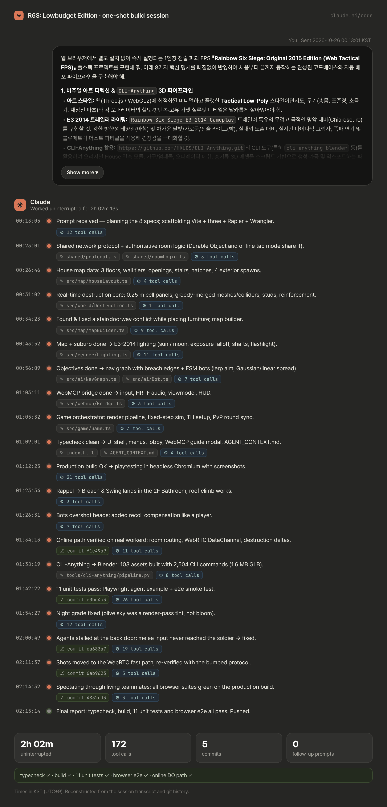
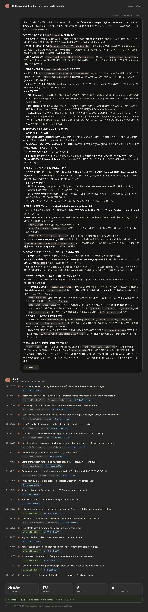

<div align="center">

[](README.md)
[](README.kr.md)

# 🛒 R6S: Lowbudget Edition

### *Rainbow Six Siege (2015), as delivered by Temu.*

Original House. Breakable walls. Rappelling. Terrorist Hunt. Room-code PvP.<br>
AI agents that play by reading the DOM. **No install.** It's a website.


</div>

> **What is this?** A fan-made, non-commercial tribute to launch-era Siege, squeezed into a browser tab:
> a low-poly reconstruction of the original 2015 **House**, real-time wall destruction, rappelling,
> Terrorist Hunt bots, PvP rooms you join with a nickname and a code like `R6-8492`, and a WebMCP
> bridge so LLM agents can join a match and play with the same inputs you have.
> Same recipe, fewer polygons, suspiciously low price.

> [!WARNING]
> **This is the one-shot build, kept as-is for the record.** It came out of a single prompt and
> about two hours of uninterrupted work (see [how it was one-shotted](#-how-it-was-one-shotted)).
> Play-testing turned up a long list of problems, summarised in the [post-mortem](#-post-mortem).
> The few-shot rebuild that fixes them lives in **[Toddoward/lowbudget-r6s](https://github.com/Toddoward/lowbudget-r6s)**.

---

## 📦 Contents

- [What's in the box](#-whats-in-the-box)
- [Game modes](#-game-modes)
- [Controls](#-controls)
- [Operators](#-operators)
- [The House](#-the-house-2015)
- [AI agents (WebMCP)](#-ai-agents-webmcp)
- [Run it locally](#-run-it-locally)
- [Deploy to Cloudflare](#-deploy-to-cloudflare)
- [How it works](#-how-it-works)
- [Post-mortem](#-post-mortem)
- [How it was one-shotted](#-how-it-was-one-shotted)

---

## 🧰 What's in the box

<table>
<tr>
<td width="50%"></td>
<td width="50%"></td>
</tr>
<tr>
<td><b>Real-time destruction.</b> Walls are 0.25 m cell grids. Rounds go through soft walls and leave
holes, a melee punches a murder hole, and breach charges, Sledge's hammer and Ash's rounds open
real passages. What you see is exactly what blocks bullets, eyes and bodies.</td>
<td><b>Three wall tiers</b> (press <kbd>T</kbd>). 🟥 Soft: breakable. 🟨 Semi-breach walls and wooden
floors: the studs stay, so you can see and shoot through but not walk through. ⬜ Solid: never.
Defenders reinforce soft walls and hatches with steel (2 each per round); only Thermite gets through.</td>
</tr>
<tr>
<td></td>
<td></td>
</tr>
<tr>
<td><b>Rappel anywhere</b> on the exterior. Climb, traverse, flip upside-down to peek, then
<b>Breach &amp; Swing</b> through a window and smash its barricade. You can also hook on from the roof edge.</td>
<td><b>E3 2014 mood lighting.</b> Morning or night is picked at random every round: a hard low sun or
a cold moon, real-time shadows, dark interiors, light shafts through windows, street lamps,
police lights, and a weapon flashlight at night.</td>
</tr>
<tr>
<td></td>
<td></td>
</tr>
<tr>
<td><b>Terrorist Hunt bots</b> that patrol, hear gunshots and breaches through floors, investigate,
take cover to reload, lay down suppressive fire through soft walls, and aim with smooth
interpolation instead of aimbot snaps.</td>
<td><b>Gunplay basics:</b> Q/E lean, ADS, crouch and prone, recoil you have to pull down,
wallbangs, and a one-shot kill on every headshot.</td>
</tr>
<tr>
<td></td>
<td></td>
</tr>
<tr>
<td><b>Prep phase:</b> attackers drive drones while defenders barricade, reinforce and set up gadgets.
Then the action phase starts.</td>
<td><b>WebMCP bridge</b> (press <kbd>B</kbd>): AI agents get only what a first-person player could know.
That means what's on screen and not behind walls, sounds from the last 3 s, and their own HUD.</td>
</tr>
</table>

---

## 🎮 Game modes

| Mode | What happens |
|---|---|
| **Terrorist Hunt** (solo) | You, plus optional AI teammates, against 12–16 "White Masks" on Normal / Hard / Realistic. Missions: **Classic** (eliminate), **Disarm Bomb**, **Hostage Rescue**, **Secure Area**. 20 s drone phase, then 6:00. |
| **PvP** (room code) | Enter a nickname and a code like `R6-8492`. Everyone with the same code lands in the same room. Each round randomly rolls **Hostage / Secure Area / Bomb**, a site, and morning/night. 45 s prep + 3:00 action, sides swap every round, first to 3 wins. |
| **Local PvP** (no server) | Choose the *Local* transport and the room is shared between tabs of the same browser. Good for testing. |
| **AI agents** | Add built-in agent slots from the lobby or TH menu (**+ 로컬 WebMCP AI 에이전트 슬롯 추가**), or let an external agent join through `window.webmcp`. |

<div align="center">


</div>

---

## ⌨️ Controls

| Key | Action | Key | Action |
|---|---|---|---|
| <kbd>W</kbd><kbd>A</kbd><kbd>S</kbd><kbd>D</kbd> | Move | <kbd>Shift</kbd> | Sprint |
| <kbd>C</kbd> / <kbd>Z</kbd> | Crouch / Prone | <kbd>Q</kbd> / <kbd>E</kbd> | Lean left / right |
| <kbd>LMB</kbd> / <kbd>RMB</kbd> | Fire / Aim down sights | <kbd>R</kbd> | Reload |
| <kbd>V</kbd> | Melee (murder holes!) | <kbd>F</kbd> | Context: barricade, reinforce, vault, hostage, defuser, rappel |
| <kbd>G</kbd> | Remote detonate | <kbd>1</kbd>–<kbd>4</kbd> | Primary, secondary, operator gadget, breach charge / barricade |
| <kbd>Space</kbd> | Vault / let go of the rope | <kbd>L</kbd> | Flashlight |
| <kbd>T</kbd> | Wall-tier X-ray | <kbd>B</kbd> | WebMCP overlay |
| <kbd>Tab</kbd> | Scoreboard | <kbd>Enter</kbd> | Skip the TH drone phase |

**On the rope:** <kbd>W</kbd>/<kbd>S</kbd> climb · <kbd>A</kbd>/<kbd>D</kbd> traverse · <kbd>Shift</kbd> fast descent · <kbd>C</kbd> invert · <kbd>F</kbd> Breach &amp; Swing · <kbd>Space</kbd> push off.

---

## 🪖 Operators

The 2015 launch roster, gadgets included, no season pass.

| Attackers | Gadget | | Defenders | Gadget |
|---|---|---|---|---|
| **Sledge** | Breaching hammer: soft walls, floors, hatches | | **Smoke** | Remote gas canisters |
| **Ash** | M120 CREM breaching rounds (ranged) | | **Mute** | Signal jammer (stops drones and breach charges) |
| **Thermite** | Exothermic charge: opens reinforced walls | | **Castle** | Bullet-proof armor panels |
| **Thatcher** | EMP grenades (kill enemy electronics) | | **Pulse** | Heartbeat sensor, works through walls |
| **Fuze** | Cluster charge (mind the hostage 😬) | | **Jäger** | ADS, shoots down grenades and rounds |
| | | | **Bandit** | Shock wire: fries Thermite charges |

---

## 🏠 The House (2015)

A data-driven reconstruction of the launch version: three floors, a roof, and four exterior spawns.

| Floor | Rooms |
|---|---|
| **Basement** | Garage (2 shutters, center pillar, car + boat cover) · Storage (NW exterior door) · Training · Laundry · stairs up to the Living Room and Kitchen · 2 ceiling hatches |
| **1F** | Lobby (front door) + main stairs · Living Room (4 windows) · Office (porch, 3 windows) · Dining · Kitchen · Pantry · Back Entrance + side stairs |
| **2F + roof** | Upper Hallway with the famous **open window** · Master Bedroom + bullet-proof walk-in closet · Bathroom (shower cover) · Kids' Room (4 windows, 3 sides) · Workshop · 2 floor hatches · porch roof and roof access |
| **Outside** | Construction Site (N) · River Docks (E) · APC Area (SW) · Side Street (S) with police cruisers |

<div align="center"></div>

---

## 🤖 AI agents (WebMCP)

Agents are first-class players. They read the `#webmcp-agent-bridge` DOM element (or call
`window.webmcp`) and act through the **same input pipeline as a human**: same physics, same
recoil, and a 540°/s turn-rate cap with interpolated aiming. No wallhacks: vision is filtered
by the camera frustum plus occlusion raycasts.

```js
await webmcp.join({ nickname: 'Temu-Thermite', roomCode: 'R6-8492' });

webmcp.subscribe((o) => {
  const enemy = o.vision.find((v) => v.kind === 'enemy');
  if (enemy) webmcp.act({
    lookLerp: { yawDelta: enemy.yawDelta, pitchDelta: enemy.pitchDelta, rate: 0.35 },
    ads: true,
    fire: Math.abs(enemy.yawDelta) < 2 ? { burst: 3 } : false,
  });
});
```

| DOM attribute | What it holds |
|---|---|
| `data-self-state` | Operator, HP, stance, lean, weapon/ammo, gadgets, room name (e.g. `2F Master Bedroom`) |
| `data-first-person-vision` | Visible enemies, allies, walls, hatches, windows, gadgets and objectives with `yawDelta` / `pitchDelta` / `distance` |
| `data-acoustic-cues` | Sounds from the last 3 s: direction relative to you (`NNE`, `Below_Floor`, …) and intensity |
| `data-match-state` | Mode, phase, timer, mission, site, score |

📖 The full contract is in **[AGENT_CONTEXT.md](AGENT_CONTEXT.md)**. It's also in the game under **[AI Agent WebMCP 접속 가이드 & 스키마 보기]**.
An example of an external agent driving a real browser is in `tools/agents/webmcp-playwright-agent.mjs`.

<div align="center"></div>

---

## 🚀 Run it locally

```bash
npm install
npm run dev            # http://localhost:5173 (TH + local multi-tab PvP work without a server)
npm run dev:worker     # optional: the Durable Object room server on :8787 (vite proxies /api)
npm run build          # typecheck (client + worker) + production build → dist/
npm test               # unit tests: room state machine, destruction, hitboxes, spread
npm run test:e2e       # browser smoke test against `vite preview`
```

URL shortcuts: `?th=1&difficulty=Hard&mission=bomb&agents=2` · `?room=R6-8492&nick=Bot&agent=1`

---

## ☁️ Deploy to Cloudflare

1. Add two repository secrets: `CLOUDFLARE_API_TOKEN` and `CLOUDFLARE_ACCOUNT_ID`.
2. Push to `main`. `.github/workflows/deploy.yml` runs typecheck, build, unit tests and the browser
   e2e test. It then deploys the room Worker + Durable Object (`worker/wrangler.toml`) and then the
   Pages site (`wrangler.toml`, which binds `ROOMS` to the Worker's Durable Object).
3. Without the secrets, CI still builds and tests, and skips the deploy.

Manual deploy: `npx wrangler login && npm run deploy`.

---

## 🔧 How it works

```
 Browser tab (Cloudflare Pages)                               Cloudflare
 ┌─────────────────────────────────────────────┐    WS     ┌──────────────────────────────┐
 │ three.js render · lighting · FX · HUD       │◀─────────▶│ Pages Function /api/room/:id │
 │ 60 Hz sim: soldiers · bots · gadgets        │           │   └─▶ Durable Object         │
 │ Rapier3D WASM: controllers, raycasts        │           │       one per room code      │
 │ Destruction: cell grids → mesh + colliders  │           │       rounds · timers · log  │
 │ WebMCP bridge: DOM + window.webmcp          │           └──────────────────────────────┘
 └──────────────────────┬──────────────────────┘
                        │ WebRTC DataChannel (P2P): snapshots + shots
                        ▼ other players
```

- **Who decides what.** The shooter decides hits and wall damage, each client decides its own
  death, and the Durable Object decides rounds (random mission, site and time of day), timers and
  winners.
- **Two lanes.** Position snapshots and shots go over unreliable WebRTC DataChannels, with a WS
  relay fallback for peers that can't connect. Everything that must arrive (hits, destruction
  deltas, gadgets, objectives) goes over the WebSocket.
- **Destruction sync.** A hit is sent as `(panel, cells, damage)`. Because damage just adds up,
  every client ends up with the same wall no matter what order the events arrive in. Late joiners
  get the round's log replayed.
- **Assets.** Weapons, operators and gadgets are described as specs. Those specs are turned into
  GLBs through [CLI-Anything](https://github.com/HKUDS/CLI-Anything)'s `cli-anything-blender`
  (`python3 tools/cli-anything/pipeline.py`), and the game falls back to building the same meshes
  in the browser.

<details>
<summary><b>Repository layout</b></summary>

```
src/map/        House layout, furniture/cover, suburb, map builder
src/world/      destruction panels (cells → mesh + colliders)
src/game/       soldier (movement, lean, rappel), combat, gadgets, objectives
src/ai/         FSM bots, navigation graph
src/net/        room client (WS + WebRTC), transports, remote players
src/webmcp/     perception, DOM bridge, agent controller, built-in agent
src/render/     lighting, effects, viewmodel, rigs
shared/         protocol + room logic (used by the Durable Object and local rooms)
worker/         Cloudflare Worker + Durable Object
functions/      Pages Functions (/api/room/:code)
tools/          CLI-Anything asset pipeline, tests, agent example
```
</details>

---

## 🩻 Post-mortem

What play-testing found in the one-shot build. Numbers match the original issue list;
🔎 marks problems found later in code review.

| Area | What's wrong |
|---|---|
| **Input** | **1** Chrome shortcuts fire mid-match (new tab, close tab). 🔎 Root cause: crouch is also bound to <kbd>Ctrl</kbd>, so <kbd>Ctrl</kbd>+<kbd>W</kbd>/<kbd>T</kbd>/<kbd>N</kbd> reach the browser.<br>**2** The cursor lock doesn't follow the game state. On death or in menus, the cursor isn't released for clicking UI, and getting back into the game takes an extra click.<br>**23** Keys are spread far apart, gadgets need too many presses, nothing adapts to context (stance or what you're looking at), and keys can't be rebound. |
| **Level** | **3** Wrong scale and proportions; hard walls, soft walls and barricades look alike. 🔎 The layout was an invented 16 × 14 m grid with 3 m floors, not derived from the reference model.<br>**5** No drone vents, and no gap under door barricades.<br>**7** Render meshes and colliders disagree, so bullets stop on thin air.<br>**13** You can't vault through a hole you blew in a wall.<br>**14** Vaulting isn't generic. It should work on anything under a height limit: climb over thin objects, climb on top of deep ones.<br>**15** A soft wall can't be reinforced once it's been shot open. Only a reinforced wall that Thermite breached should be lost for good. |
| **Gunplay** | **4** Leaning with Q/E moves the sight off the bullet line.<br>**16** Some optics are covered by the gun model (MP5K, MP7, L85A1, …).<br>**17** Red dots are pinned to the screen instead of being collimated, so the dot and the bullet disagree.<br>**18** Pistol iron sights: the rear notch is blocked and the front post has no glow dot. |
| **Drone** | **6** The jump is too weak to hop door frames or climb onto props.<br>**8** You can't ping enemies.<br>**9 · 22** The night feed is too dark to scout with, and the drone view should be brighter in general. |
| **AI** | **10** A bot's first shot always hits. |
| **UI / UX** | **12** The HUD is crude and leaves out information you need.<br>**19** Hands and guns lack detail, there are no equip or switch animations, and gadgets give no feedback (Bandit's battery has no sparks and no buzz).<br>**20** The UI is English-only, and match-state transitions feel abrupt.<br>**25** The main menu's structure and depth are confusing.<br>**26** The name is too close to the original. It needs its own identity (R6S: TEMU / LOWBUDGET).<br>**27** There were no end-to-end UX scenarios (menu → match, state handling, attack and defense per role). |
| **Content** | **21** IQ, Montagne, Blitz, Kapkan and Tachanka are missing. |
| **Product** | **11** Agents, local or cloud, are meant to be able to join and play. Keep that, but don't let it clutter the human UI.<br>**24** QA tools (local agent slots, same-browser transport, debug overlays) ship in production. They belong on a develop branch. |
| **Net** 🔎 | A dropped WebSocket isn't retried, so you're removed from the match immediately.<br>Hits and kills come from clients and are relayed as-is, so a modified client can claim any kill.<br>There are only 10,000 room codes (`R6-0000`…`R6-9999`): collisions, and rooms anyone can guess. |
| **Platform** | Mouse and keyboard only, and pointer lock is required, so there's no mobile support. The screenshots come from a software renderer. |

---

<div align="center">
<sub>Not affiliated with Ubisoft. "Rainbow Six Siege" and the operator names belong to their owners.
This is a non-commercial fan tribute with original low-poly assets. Please don't send us to customs. 📦</sub>
</div>

---

## 📼 How it was one-shotted

One prompt in, a deployable game out: **2 h 02 m** of uninterrupted work, **172** tool calls,
**5** commits, and no follow-up prompts. The image below replays the session in a Claude-style
dark chat. The prompt is collapsed by default.

<p align="center"></p>

<details>
<summary><b>Show more</b>: the full prompt</summary>
<br>
<p align="center"></p>
</details>
